# 🍄 Precision QC — ระบบตรวจสอบความสมบูรณ์ของเชื้อรา

ระบบวิเคราะห์ภาพ 2 งาน ในเว็บเดียว (เปิดสลับหน้าได้):

| หน้า | ทำอะไร |
|---|---|
| 🧫 **ตรวจจานเพาะเชื้อ** (`index.html`) | วิเคราะห์ภาพโคโลนีเชื้อรา (เส้นใย / mycelium) บนจานเพาะเชื้อ แล้วตัดสินผล **PASS / FAIL** พร้อมคะแนน เกรด และภาพประกอบ 8 ส่วน (ตามรูปแบบรายงาน Precision QC) |
| 🍄 **นับจำนวนดอกเห็ด** (`caps.html`) | นับดอก (หมวก) ในช่อเห็ดจากภาพถ่าย แบ่งขนาดเล็ก/กลาง/ใหญ่ ประมาณดอกที่ซ่อนใต้ดอกอื่น คิด % พื้นที่ต่อพื้นที่ช่อ พร้อมภาพเทคนิคทีละขั้นและรายงาน PDF |

ตัวประมวลผลเขียนด้วย **Python** (ใช้แค่ `numpy` + `Pillow`) โค้ดชุดเดียวกันรันได้ 3 ทาง:

| วิธี | ใช้ทำอะไร |
|---|---|
| 🌐 **เว็บบน GitHub Pages** | เปิดเว็บ อัปโหลดภาพ เห็นผลทันที — Python รันในเบราว์เซอร์ผ่าน [Pyodide](https://pyodide.org) ไม่ต้องมีเซิร์ฟเวอร์ ภาพไม่ถูกส่งออกไปไหน |
| ⚙️ **GitHub Actions (QC Batch)** | push ภาพเข้าโฟลเดอร์ `inputs/` → ได้ตาราง PASS/FAIL ในหน้า Summary + ไฟล์รายงานให้ดาวน์โหลด |
| 💻 **Command line / Codespaces** | `python -m precision_qc <โฟลเดอร์ภาพ>` (ตรวจจาน) · `python -m precision_qc <โฟลเดอร์ภาพ> --caps` (นับดอก) |

## ภาพรวมการใช้งาน

### นับจำนวนดอกเห็ด — ผลลัพธ์
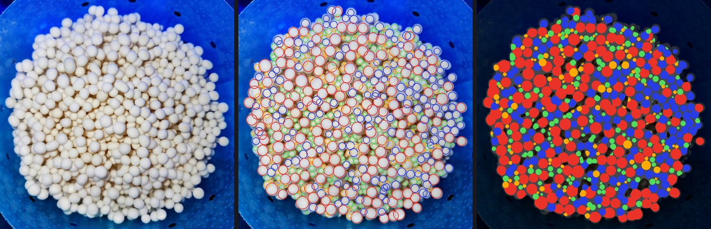
<sub>ซ้าย: ภาพช่อดอกต้นฉบับ (ครอปเฉพาะช่อ) · กลาง: วงล้อมทุกดอก — เขียว เล็ก · น้ำเงิน กลาง · แดง ใหญ่ · ส้ม ดอกที่ซ่อนใต้ดอกอื่น · ขวา: แผนที่สัดส่วนพื้นที่ต่อพื้นที่ช่อ (เทา = ก้าน/ช่องว่าง)</sub>

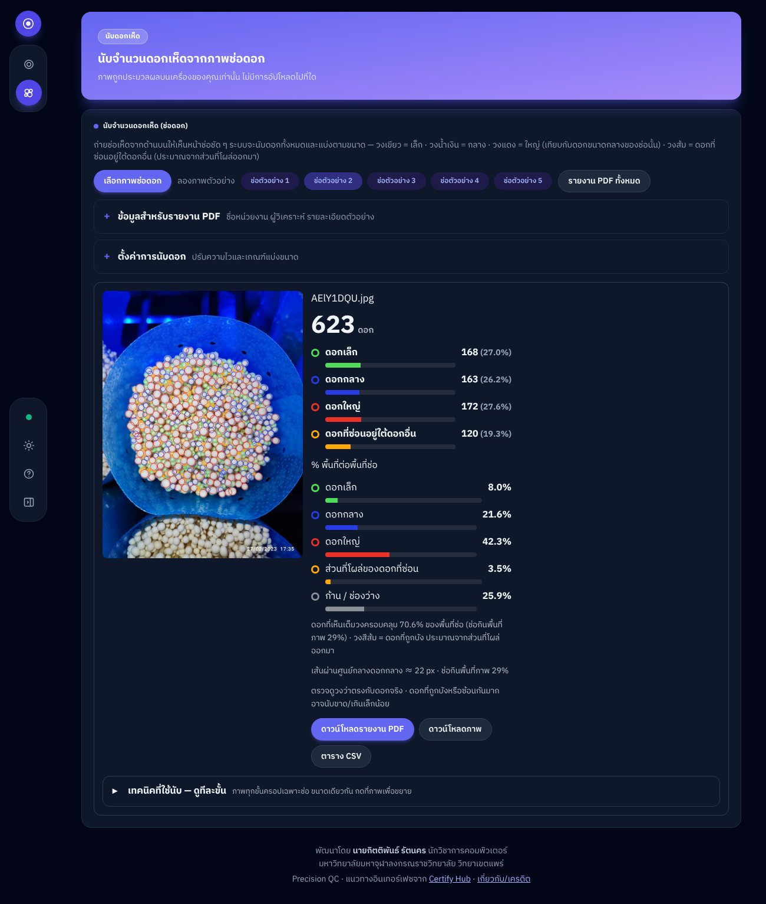
<sub>หน้านับดอกเวอร์ชัน Dashboard (โหมดมืด) — การ์ดผลลัพธ์: ตัวเลขสำคัญ (จำนวนรวม เส้นผ่านศูนย์กลางมัธยฐาน พื้นที่ช่อ ความหนาแน่น) · ตารางจำนวน/สัดส่วน/พื้นที่ต่อพื้นที่ช่อแยกตามขนาด · แถบองค์ประกอบพื้นที่ช่อ · ปุ่มรายงาน PDF / ภาพ / CSV และแถบเทคนิคทีละขั้น</sub>

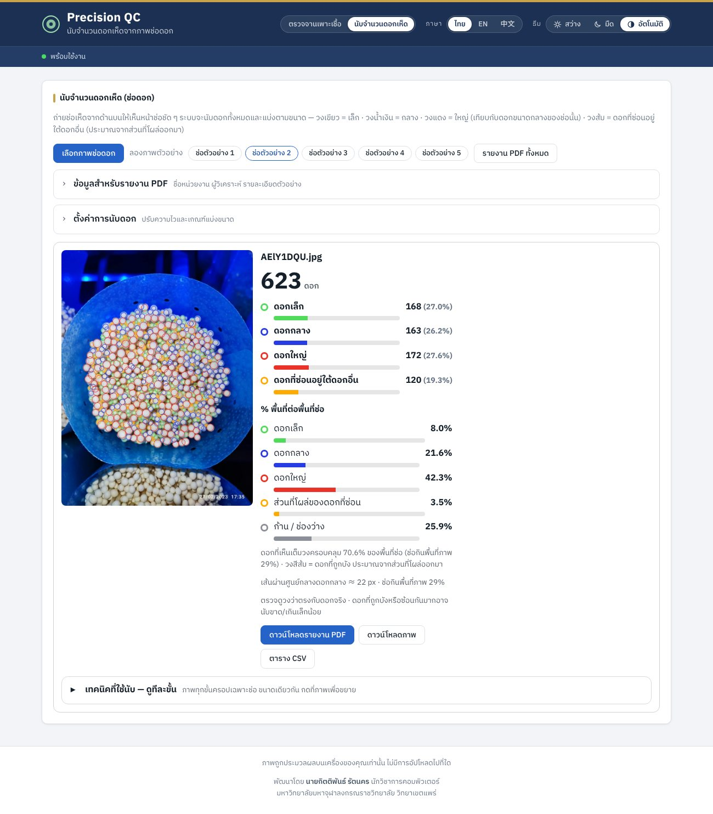
<sub>เวอร์ชัน Pure.css (โหมดสว่าง) — ฟังก์ชันเหมือนกัน ต่างกันที่หน้าตา</sub>

### ตรวจจานเพาะเชื้อ — ผลลัพธ์
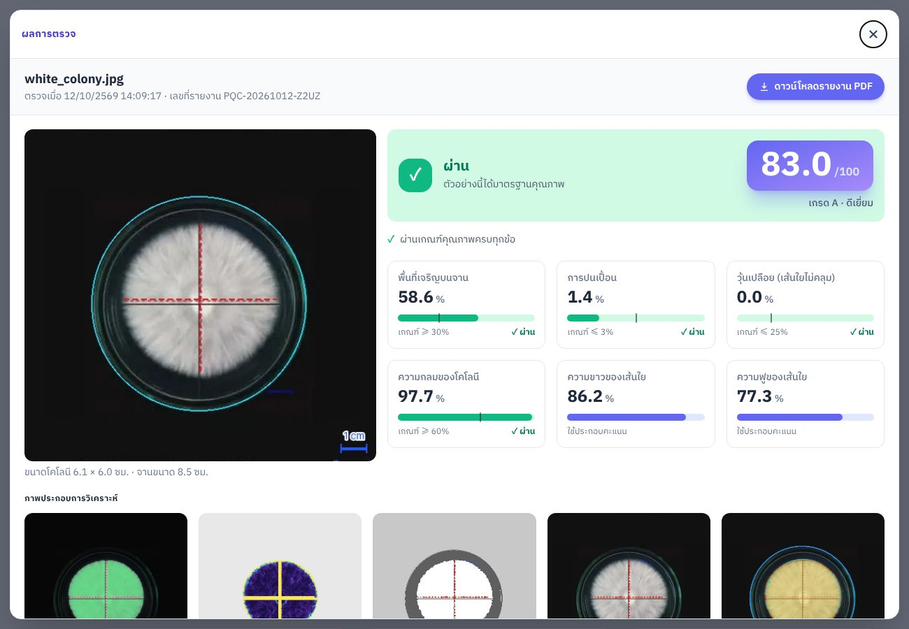
<sub>ผลตรวจจาน white_colony: PASS คะแนน 83.0 เกรด A พร้อมเกณฑ์ที่ใช้ตัดสินแต่ละข้อ และภาพประกอบการวิเคราะห์</sub>

---

## เริ่มใช้งานบน GitHub

### 1) เปิดเว็บด้วย GitHub Pages
1. Push โค้ดขึ้น branch `main`
2. ไปที่ **Settings → Pages → Build and deployment → Source** เลือก **GitHub Actions**
3. กด *Run workflow* ที่ workflow **Deploy web app to GitHub Pages** ในแท็บ Actions (ตอนนี้ **ปิดการรันอัตโนมัติ** ตอน push แล้ว — ถ้าอยากให้ deploy เองทุกครั้งที่ push เข้า `main` ให้เพิ่ม `push: branches: [main]` กลับใน `.github/workflows/pages.yml`)
4. เปิด `https://<username>.github.io/<repo>/` (หน้าตรวจจาน) หรือ `.../caps.html` (หน้านับดอกเห็ด) → ลากภาพมาวาง หรือกดปุ่มภาพตัวอย่าง

### 2) อัปโหลดขึ้นโฮสต์จริง (Shared hosting / Apache / Nginx)
ไฟล์ที่พร้อมอัปโหลดอยู่ในโฟลเดอร์ **`deploy/`** แล้ว โดยแยกเป็น **2 โฟลเดอร์ย่อยตามเวอร์ชันหน้าตา** (ดูหัวข้อถัดไป) เว็บนี้เป็น static ทั้งหมด จึงไม่ต้องติดตั้ง Python หรือฐานข้อมูลบนเซิร์ฟเวอร์

1. เลือกเวอร์ชันที่ต้องการ แล้วอัปโหลด**ไฟล์ทั้งหมดในโฟลเดอร์นั้น** (ไม่ใช่ตัวโฟลเดอร์) ขึ้น `public_html/` หรือโฟลเดอร์ย่อย เช่น `public_html/qc/`
   - เวอร์ชัน Pure.css (รองรับถ่ายจากกล้อง) → เนื้อในโฟลเดอร์ `deploy/pure/`
   - เวอร์ชัน Dashboard (แดชบอร์ดสีม่วง เมนูด้านซ้าย รองรับถ่ายจากกล้อง) → เนื้อในโฟลเดอร์ `deploy/dashboard/`
   - ถ้าต้องการให้เลือกได้ทั้งคู่ ให้อัปโหลดทั้งโฟลเดอร์ `deploy/` (จะมีหน้าแรกให้เลือกเวอร์ชัน และเข้าได้ที่ `/pure/` กับ `/dashboard/`)
   ใช้ FTP/SFTP (FileZilla) หรือ File Manager ของ cPanel/DirectAdmin
2. ต้องมีไฟล์ซ่อน **`.htaccess`** ไปด้วย (ใน FileZilla เปิด *Server → Force showing hidden files*)
   ไฟล์นี้กันไม่ให้เซิร์ฟเวอร์รันไฟล์ `.py` เป็นสคริปต์ และตั้งค่า cache ให้เห็นเวอร์ชันใหม่ทันที
3. เปิด `https://<โดเมน>/` (หรือ `https://<โดเมน>/qc/`) ผ่าน **HTTPS** แล้วลองกดภาพตัวอย่าง

เครื่องผู้ใช้ต้องต่ออินเทอร์เน็ตได้ เพราะหน้าเว็บโหลด Pyodide และฟอนต์จาก CDN (เวอร์ชัน Pure.css โหลด Pure.css จาก CDN ด้วย ส่วนเวอร์ชัน Tailwind รวม CSS มาในไฟล์แล้ว)
ถ้าใช้ **Nginx** (ไม่อ่าน `.htaccess`) ให้ตั้ง `location ~ \.py$ { default_type text/plain; }` แทน

**อัปเดตเวอร์ชัน:** หลังแก้โค้ดใน `web/` หรือ `precision_qc/` ให้สร้างโฟลเดอร์ใหม่ แล้วอัปโหลดทับทั้งหมด
```bash
python scripts/build_site.py --out deploy --lock-domain kittiphun.rut.mcupr.ac.th
```
CI จะแจ้งเตือนถ้าโฟลเดอร์ `deploy/` ไม่ตรงกับโค้ดล่าสุด (โดเมนที่ล็อกอยู่ในไฟล์ `hosting/deploy-domains.txt`)

### เวอร์ชันหน้าตา: Pure.css · Dashboard
ทุกครั้งที่ build จะได้เว็บ **สองเวอร์ชัน** จากโค้ดชุดเดียวกัน (ตรรกะการตรวจและรายงาน PDF เหมือนกันทุกอย่าง ต่างกันแค่สไตล์):

การ build แยกแต่ละเวอร์ชันไว้คนละโฟลเดอร์ (self-contained อัปโหลดทั้งก้อนได้เลย):

| เวอร์ชัน | โฟลเดอร์ | เปิดใช้งานที่ | ต้นทาง |
|---|---|---|---|
| Pure.css (เดิม + กล้อง) | `deploy/pure/` | `https://<โดเมน>/pure/` | `web/` |
| Dashboard (แดชบอร์ดม่วง + กล้อง) | `deploy/dashboard/` | `https://<โดเมน>/dashboard/` | `web-dashboard/` |

- โฟลเดอร์ `deploy/` ยังมีหน้าแรก (`index.html`) ให้ผู้ใช้เลือกเวอร์ชัน หากอัปโหลดทั้ง `deploy/`
- เวอร์ชัน Dashboard คอมไพล์ CSS จาก `web-dashboard/src.css` เป็น `tw-dash.css` ตอน build (ต้องมี **Node.js/npx**) และไม่พึ่ง Pure.css CDN
- แก้สไตล์เวอร์ชัน Dashboard ได้ที่ `web-dashboard/src.css` (คลาสคอมโพเนนต์) และ `web-dashboard/tailwind.config.js`

### อินเทอร์เฟซเวอร์ชัน Dashboard (แนวทางเดียวกับ Certify Hub)
หน้าตาของเวอร์ชัน Dashboard ปรับตามหน้าแอดมินของโครงการ [Certify Hub](https://github.com/kittiphunr/certify-hub): **แถบเมนูด้านข้าง** แบบแคปซูลลอย (โลโก้ · ภาพรวม / อัปโหลด / ตั้งค่าเกณฑ์ / ผลตรวจ · สถานะระบบ · ตั้งค่าการแสดงผล · เกี่ยวกับ/เครดิต · ปุ่มยุบ/ขยาย) — ค่าเริ่มต้นเป็นแถบไอคอน ชี้เมาส์แล้วขยาย กดปุ่มเพื่อปักให้ขยายค้างไว้ (จำค่าไว้) ไฮไลต์เมนูตามหัวข้อที่เลื่อนอ่านอยู่ และบนมือถือเป็นปุ่มลอยเปิดลิ้นชักเมนู
แผง **ตั้งค่าการแสดงผล** มีภาษา ธีม (สว่าง/มืด/อัตโนมัติ) และขนาดตัวอักษร (เล็ก/ปกติ/ใหญ่) · แถบ 3 ขั้นตอน · ท้ายเว็บมีเครดิตผู้พัฒนา
หน้าต่าง **เกี่ยวกับ/เครดิต** (3 ภาษา) แสดงข้อมูลผู้พัฒนาและช่องทางติดต่อเหมือน Certify Hub, ข้อมูลโครงการ, **เทคโนโลยีและทรัพยากรที่นำมาใช้พร้อมสัญญาอนุญาต** (รายการเดียวกับ [THIRD-PARTY-NOTICES.md](THIRD-PARTY-NOTICES.md)) และ **สิทธิ์และการอ้างอิง** (ลิขสิทธิ์ เครื่องหมายการค้า มาตรฐานที่อ้างอิง ความเป็นส่วนตัว)
โค้ดส่วนนี้อยู่ใน `web-dashboard/ui-dash.js` (ค่า `CREDITS`) และ `web-dashboard/index.html`

### ถ่ายภาพจากกล้อง (webcam)
- **ถ่ายภาพจากกล้อง (webcam):** ใช้ได้ทั้งหน้าตรวจจานและหน้านับดอกเห็ด (ปุ่ม "ถ่ายภาพจากกล้อง" ใต้กรอบลากวางภาพ) กดปุ่ม "ถ่ายภาพจากกล้อง" เพื่อเปิดกล้อง เล็งจานเพาะเชื้อให้อยู่กลางภาพ แล้วกด "ถ่ายภาพ" ระบบจะนำภาพเข้าสู่การตรวจทันทีเหมือนการอัปโหลดไฟล์ รองรับการเลือกกล้องเมื่อมีหลายตัว
- ⚠️ เบราว์เซอร์อนุญาตให้ใช้กล้องเฉพาะบน **HTTPS** (หรือ `localhost`) เท่านั้น และผู้ใช้ต้องกด "อนุญาต" ให้เว็บเข้าถึงกล้อง — บนโฮสต์จริงที่เป็น HTTPS จึงใช้งานได้
- โค้ดกล้อง `initCamera(onCapture)` อยู่ใน `common.js` ที่ใช้ร่วมกันทั้งสองหน้าและทุกเวอร์ชัน (หน้าตรวจจานส่งภาพเข้า `runFiles` หน้านับดอกส่งเข้า `runCaps`) ทั้งเวอร์ชัน Pure.css และ Dashboard มีส่วนติดต่อกล้อง

### การป้องกันการคัดลอกบนโฮสต์จริง
ทั้งสองเวอร์ชันในโฟลเดอร์ `deploy/` ใส่ระบบป้องกันการคัดลอกไว้แล้ว (ไฟล์ต้นทางใน `web/` ยังอ่านง่ายเหมือนเดิม):
- **ล็อกโดเมน** — เว็บจะทำงานเฉพาะบนโดเมนที่กำหนด (`--lock-domain`) เท่านั้น บวก `localhost` สำหรับทดสอบ ถ้ามีคนคัดลอกไฟล์ไปวางบนโดเมนอื่นหรือเปิดจากไฟล์ในเครื่อง หน้าเว็บจะขึ้นข้อความแจ้งว่าไม่ได้รับอนุญาตและเครื่องมือตรวจจะไม่เริ่มทำงาน
- **ย่อ/กวนโค้ด (minify)** — JavaScript ที่อัปโหลดถูกย่อให้อ่านยาก ด้วย `terser` (ต้องมี Node.js ตอน build)
- **กันการเปิดดูแบบง่าย ๆ** — ปิดคลิกขวา, ลากภาพ และปุ่มลัด F12 / Ctrl+Shift+I / Ctrl+U / Ctrl+S

> ⚠️ **สิ่งเหล่านี้เป็นแค่การ "กันคนทั่วไป" ไม่ใช่ระบบความปลอดภัยจริง** — อะไรก็ตามที่ส่งไปแสดงบนเบราว์เซอร์ ผู้ที่ตั้งใจจริงยังอ่านและคัดลอกได้เสมอ การป้องกันที่ได้ผลจริงคือ **การเก็บ repository ต้นทางให้เป็น private** (ตอนนี้เป็น private อยู่แล้ว) หากต้องการกันการนำไปใช้ซ้ำอย่างเด็ดขาด ควรย้ายการประมวลผลไปไว้ฝั่งเซิร์ฟเวอร์แทนการรันในเบราว์เซอร์ และคุ้มครองด้วยสัญญาอนุญาต/ลิขสิทธิ์

### การเก็บ log การใช้งาน (แนวทาง)
แนวทางเก็บข้อมูลการใช้งานจริงเพื่อพัฒนาระบบ — เก็บเฉพาะตัวเลข/เมทาดาทา ไม่เก็บภาพ ขออนุญาตผู้ใช้ก่อนส่งออกนอกเครื่อง พร้อม schema และขั้นตอนการทำ ดูที่ [docs/LOGGING.md](docs/LOGGING.md) — เว็บเก็บในเครื่องผู้ใช้ (ดาวน์โหลดได้ที่ท้ายหน้า) ส่วน CLI ใช้ `python -m precision_qc <โฟลเดอร์ภาพ> --log-dir logs`

### ภาษา · Language · 语言
- หน้าเว็บและรายงาน PDF รองรับ **ไทย · English · 中文** — สลับได้จากปุ่มมุมขวาบน ระบบจำภาษาที่เลือกไว้
- ลิงก์ตรงเข้าภาษาที่ต้องการ: `?lang=th`, `?lang=en`, `?lang=zh`
- รายงาน PDF ออกเป็นภาษาที่เลือกอยู่ขณะกดดาวน์โหลด (ชื่อไฟล์ลงท้าย `_TH`, `_EN`, `_ZH`)
- ข้อความทั้งหมดอยู่ในไฟล์ `web/i18n.js` แก้คำแปลได้ที่เดียว

### หน้าตาเว็บ · โหมดสว่าง / มืด
- จัดหน้าด้วย **[Pure.css](https://pure-css.github.io/) 3.0** (grid, ปุ่ม, ฟอร์ม, ตาราง) เสริมด้วย `web/style.css`
- ปุ่ม **สว่าง · มืด · อัตโนมัติ** มุมขวาบน — "อัตโนมัติ" ตามการตั้งค่าของระบบปฏิบัติการ ระบบจำค่าที่เลือกไว้
- มีแถบขั้นตอนการใช้งาน 3 ขั้น (อัปโหลด → ตรวจสอบผล → ดาวน์โหลดรายงาน) และรองรับมือถือ
- รายงาน PDF เป็นพื้นขาวเสมอ ไม่ว่าจะใช้โหมดใด

### รายงาน PDF (A4 แนวตั้ง)
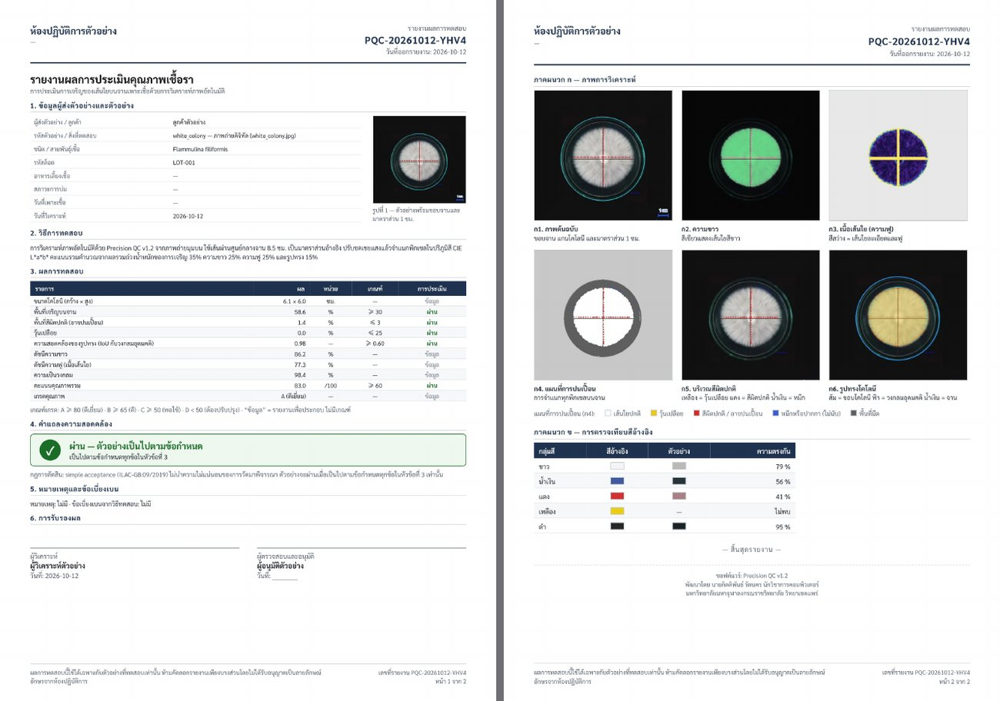
<sub>รายงานตรวจจาน 2 หน้า (ข้อมูลหน่วยงานในภาพเป็นข้อมูลตัวอย่าง) — รายงานของหน้านับดอกอยู่ในหัวข้อ “นับจำนวนดอกเห็ด”</sub>

- กด **ดาวน์โหลดรายงาน PDF** ที่การ์ดของแต่ละภาพ หรือ **รายงาน PDF ทั้งหมด** เพื่อรวมทุกภาพไว้ในไฟล์เดียว
- กรอกข้อมูลหน่วยงาน ผู้วิเคราะห์ และรายละเอียดตัวอย่างในหัวข้อ **ข้อมูลสำหรับรายงาน PDF** ระบบจะจำค่าไว้ในเบราว์เซอร์
- โครงสร้างรายงานตาม **ISO/IEC 17025:2017 ข้อ 7.8**: ชื่อหน่วยงาน, เลขที่รายงานเฉพาะบนทุกหน้า, หน้า x จาก y,
  ข้อมูลลูกค้าและตัวอย่าง, วันที่ (รูปแบบ ISO 8601), วิธีทดสอบ, ผลพร้อมหน่วยและเกณฑ์, คำแถลงความสอดคล้อง
  (decision rule แบบ simple acceptance ตาม ILAC-G8:09/2019), หมายเหตุ/ข้อเบี่ยงเบน, ผู้วิเคราะห์และผู้อนุมัติ,
  ข้อความจำกัดความรับผิด และเครื่องหมายสิ้นสุดรายงาน — หน้า 2 เป็นภาคผนวกภาพวิเคราะห์

### 2) ตรวจภาพเป็นชุดด้วย GitHub Actions
- วางภาพใน `inputs/` แล้ว commit + push → workflow **QC Batch** รันเอง
- หรือไปที่ **Actions → QC Batch → Run workflow** แล้วกำหนด `folder`, `min_score`, `plate_cm`, `strict`
- ผลลัพธ์: ตารางในหน้า run summary และ artifact `qc-reports` (ภาพรายงาน PNG, JSON, `summary.csv`)

### ตรวจแบบชุด: หลายจานในภาพเดียว (`--multi`)
ถ่ายจานเพาะเชื้อหลายจานในภาพเดียว (ตัวอย่างใน `samples/แบบชุด/`) แล้วให้ระบบแยกจานออกมาประเมินทีละจานและจัดอันดับ

```bash
python -m precision_qc "samples/แบบชุด" --multi -o reports
```

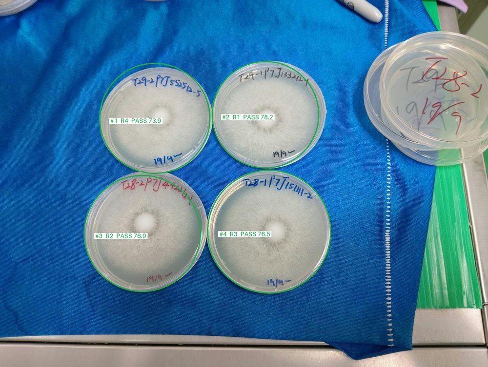
<sub>`<ภาพ>_overview.png` — จานแต่ละใบถูกแยกออก ประเมินทีละจาน และจัดอันดับ</sub>

1. **แยกจาน** — หาวงกลมของจานทุกใบด้วย Hough transform หลายวง แล้วปรับขอบให้แม่นบนภาพความละเอียดเต็ม
   จานที่ถูกขอบภาพตัดครึ่ง หรือจานที่ซ้อน/ทับกัน (เช่น กองจานที่มุมภาพ) จะ**ไม่ถูกนับ**
2. **ประเมินทีละจาน** — ใช้เกณฑ์และคะแนนเดียวกับโหมดปกติ (PASS / FAIL, เกรด) ตั้งเลขจานตามตำแหน่ง: บนลงล่าง ซ้ายไปขวา (`#1`, `#2`, …)
3. **จัดอันดับ** — PASS มาก่อน FAIL → คะแนนสูงกว่า → ปนเปื้อนน้อยกว่า ได้ทั้งอันดับในภาพ (`rank`) และอันดับรวมทุกภาพ (`overall_rank`)

ผลลัพธ์: `<ภาพ>_overview.png` (ภาพต้นฉบับวงกลมแต่ละจานพร้อมเลขจาน อันดับ ผล), `<ภาพ>_p<N>.json` และ `_report.png` ต่อจาน,
`summary.csv / summary.json / summary.md` เรียงตามอันดับรวม — ใช้กับ GitHub Actions ได้เช่นกัน
(ในโค้ด: `precision_qc.batch.analyze_plates(...)` และ `precision_qc.api.analyze_plates_to_json(...)`)

> ข้อจำกัด: ควรถ่ายจากด้านบน จานทั้งใบอยู่ในภาพ และจานมีขนาดใกล้เคียงกัน (จานที่ขนาดต่างจากค่ากลางเกิน ~30% จะถูกตัดทิ้ง)
> การหาวงกลมไม่แม่นเท่าโหมดจานเดียวเล็กน้อย ตรวจดู `_overview.png` ทุกครั้งว่าวงกลมตรงกับจาน

**บนหน้าเว็บ (ทุกเวอร์ชัน):** ติ๊ก **“ตรวจแบบชุด (หลายจานในภาพเดียว)”** เหนือช่องอัปโหลด แล้วอัปโหลด/ถ่ายภาพหรือกดปุ่ม “ชุดตัวอย่าง” —
ได้การ์ด **ผลการตรวจแบบชุด** (ภาพวงจานพร้อมอันดับ + ตารางจัดอันดับ + ปุ่ม PDF ทั้งชุดเรียงตามอันดับ) และการ์ดผลของแต่ละจาน
(แสดงเป็น `ชื่อภาพ #เลขจาน` พร้อมป้ายอันดับ) ซึ่งเข้าตารางสรุป / CSV / รายงาน PDF เหมือนภาพปกติ
(ไฟล์ CSV มีคอลัมน์ `photo`, `plate`, `rank_in_photo` เพิ่ม) การ์ดอันดับของแต่ละจานมีช่อง **รหัสจาน** ให้พิมพ์รหัสที่เขียนบนจานแต่ละใบ (Enter = จานถัดไป) — รหัสจะแสดงบนภาพรวม ตารางสรุป การ์ดผล รายงาน PDF และ CSV
ในช่องเดียวกันมี **แถบขอบจานด้านบน/ล่าง** ที่คลี่เป็นเส้นตรงและเน้นรอยปากกา (คลิกเพื่อขยาย, ปุ่ม "หมุน 180°" เมื่อตัวหนังสือกลับหัว) ช่วยให้อ่านรหัสบนจานได้ง่ายขึ้น
(ระบบไม่อ่านลายมือเอง — ลองใช้ Tesseract OCR แล้วอ่านลายมือบนจานไม่ได้ ผู้ใช้เป็นคนกรอก และรหัสคงอยู่เมื่อกด "ตรวจใหม่ด้วยเกณฑ์นี้") การเลือกโหมดถูกจำไว้ในเบราว์เซอร์ — ภาพตัวอย่างชุดมาจาก `samples/แบบชุด/`

### นับจำนวนดอกเห็ด (ช่อดอก) — `--caps`
ถ่ายช่อเห็ด (เช่น เห็ดเข็มทอง) จากด้านบน ระบบนับ**ดอก (หมวก) ทั้งหมดในช่อ**และแบ่งตามขนาด ตัวอย่างภาพอยู่ใน `samples/ช่อดอก/`
(`ogH13y9c.jpg` และ `sVrmKJ-V.jpg` เป็นภาพแนวทางที่มีวงสีอยู่แล้ว ไม่ใช่ภาพต้นฉบับ — เว็บและ CI ข้ามสองภาพนี้)

```bash
python -m precision_qc "samples/ช่อดอก" --caps -o reports-caps
python -m precision_qc my_bunch.jpg --caps --set contrast=4 --set large_above=1.3
```

1. **หาช่อ** — เลือกก้อนสีขาว/ครีมที่ใหญ่ที่สุดและไม่ใช่สีน้ำเงิน (ถุง/พื้นหลังสีน้ำเงิน และช่อข้างเคียงที่ถูกขอบภาพตัดจะไม่ถูกนับ)
2. **แยกดอก** — พิกเซลที่สว่างกว่าบริเวณรอบข้างคือตัวดอก ร่องมืดระหว่างดอกที่ติดกันทำให้แยกออกจากกัน
3. **หาจุดศูนย์กลางและรัศมี** — ด้วย distance transform หนึ่งวงต่อหนึ่งดอก
4. **แบ่งขนาด** — เทียบกับรัศมีมัธยฐานของช่อนั้น: เล็กกว่า 0.85× = **เล็ก** (วงเขียว) · มากกว่า 1.20× = **ใหญ่** (วงแดง) · ที่เหลือ = **กลาง** (วงน้ำเงิน)

5. **ค้นหาซ้ำหลายมุมสี (`multi_view`)** — วิธีเดียวมองไม่ครบ จึงตรวจซ้ำบน **ช่อง B, ค่า RGB ต่ำสุด (min(R,G,B) — เฉพาะดอกขาวที่ยังสว่าง) และภาพความสว่างหลายระดับ/หลายขนาดหน้าต่าง** (ภาพ invert ให้ผลเดียวกับการหาจุดสว่างในภาพปกติ เพราะดอกจะกลายเป็นจุดมืดพอดี) เพื่อจับดอกเล็กในช่องว่างและดอกครีมในเงา; วงกลมใหม่แต่ละวงต้อง **ไม่ซ้ำกับวงเดิม, ไม่ทับดอกอื่นเกินครึ่ง และสว่างกว่าวงแหวนรอบนอกตลอดแนวขอบส่วนใหญ่** จึงจะนับ ปิดได้ด้วย `multi_view=0`; ท้ายสุดตัดวงที่ซ้อนกันซ้ำบนดอกเดียวออก
6. **หาดอกที่ซ่อนอยู่ใต้ดอกอื่น** — ลบดอกที่เห็นเต็มวงออก แล้ว**ยกเงา (gamma) และใช้ความอิ่มสี** แยกส่วนสีซีดที่โผล่ออกมาเป็นเสี้ยว ๆ ออกจากก้านที่ออกเหลือง จากนั้นฟิตวงกลมจากขอบด้านที่ไม่ติดดอกอื่น เพื่อประมาณดอกเต็มวงที่ถูกบัง (วงสีส้ม พร้อมไฮไลต์ส่วนที่โผล่) — นับรวมในจำนวนทั้งหมดและแสดงแยกเป็น `hidden`
7. **% พื้นที่ต่อพื้นที่ช่อ** — พื้นที่ช่อ = รอยเท้าของช่อทั้งก้อน (รวมช่องว่าง) แล้วรายงานสัดส่วนที่ดอกเล็ก/กลาง/ใหญ่ครอบคลุม, ส่วนที่โผล่ของดอกที่ซ่อน และก้าน/ช่องว่าง (`area_percent` ในไฟล์ JSON)

ผลลัพธ์: `<ภาพ>_caps.png` (ภาพวงดอก), `<ภาพ>_caps.json`, `caps_summary.csv / .md` — ใช้กับ GitHub Actions ได้เช่นกัน
ปรับได้ด้วย `contrast` (สูง = เข้มงวดขึ้น นับน้อยลง), `small_below`, `large_above`, `multi_view` (0 = ปิดการค้นหาซ้ำหลายมุมสี), `find_hidden` (0 = ปิดการหาดอกที่ซ่อน), `hidden_sat`, `shadow_lift` (ดู `CapConfig` ใน `precision_qc/caps.py`)
**บนหน้าเว็บ (ทุกเวอร์ชัน):** อยู่ในหน้าแยกต่างหาก **`caps.html`** (เมนู "นับจำนวนดอกเห็ด" บนแถบด้านบนของ Pure.css / แถบเมนูด้านข้างของ Dashboard; หน้าตรวจจานเพาะเชื้อยังอยู่ที่ `index.html`) — การ์ด **นับจำนวนดอกเห็ด (ช่อดอก)** — ลากภาพมาวางในกรอบ (หรือคลิกเลือกไฟล์ / ถ่ายจากกล้อง) หรือกด “ช่อตัวอย่าง” จะได้ภาพวงดอก จำนวนรวม จำนวนและสัดส่วนแต่ละขนาด พร้อมแถบ % พื้นที่ต่อพื้นที่ช่อ และปุ่มดาวน์โหลดภาพ/CSV
(ในโค้ด: `precision_qc.caps.count_caps(...)` และ `precision_qc.api.count_caps_to_json(...)`)

**รายงาน PDF ของการนับดอก:** ปุ่ม "ดาวน์โหลดรายงาน PDF" ที่การ์ดผลของแต่ละภาพ และ "รายงาน PDF ทั้งหมด" (A4 โครงสร้างเดียวกับรายงานตรวจจาน อ้างอิง ISO/IEC 17025:2017 ข้อ 7.8: เลขที่รายงาน `PQC-C-…` บนทุกหน้า, หน้า x จาก y, ผู้ส่งตัวอย่าง/ตัวอย่าง, วิธีทดสอบ, ผลพร้อมหน่วย, **ข้อจำกัดของผล**, หมายเหตุ, ผู้วิเคราะห์/ผู้อนุมัติ, ข้อความจำกัดความรับผิด) 3 หน้า — หน้า 1 สรุปผล (จำนวนตามขนาด, สัดส่วนพื้นที่ต่อพื้นที่ช่อ, เส้นผ่านศูนย์กลางมัธยฐาน, ความหนาแน่น) · หน้า 2 ภาคผนวก ก ภาพผลการนับและแผนที่พื้นที่ · หน้า 3 ภาคผนวก ข เทคนิคที่ใช้นับทีละขั้น (11 ภาพ) ไม่มีคำแถลงความสอดคล้อง เพราะการนับไม่มีเกณฑ์ผ่าน/ไม่ผ่าน รายงานออกเป็นภาษาที่เลือกอยู่ (ไทย · English · 中文) และใช้ช่อง **ข้อมูลสำหรับรายงาน PDF** ชุดเดียวกับหน้าตรวจจาน (ชื่อหน่วยงาน ผู้ส่งตัวอย่าง ผู้วิเคราะห์ ฯลฯ — กรอกครั้งเดียวใช้ได้ทั้งสองหน้า) โค้ดสร้าง PDF อยู่ใน `makePdf()` ของ `common.js` ที่สองหน้าใช้ร่วมกัน

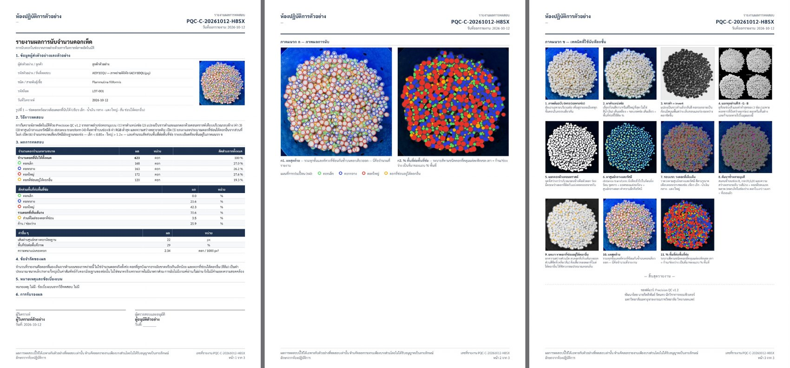
<sub>รายงานนับดอก 3 หน้า: สรุปผล · ภาคผนวก ก ภาพผลการนับ · ภาคผนวก ข เทคนิคทีละขั้น (ข้อมูลหน่วยงานในภาพเป็นข้อมูลตัวอย่าง)</sub>

**ภาพเทคนิคการนับทีละขั้น:** ใต้ผลลัพธ์ของแต่ละภาพมีแถบ "เทคนิคที่ใช้นับ — ดูทีละขั้น" แสดง 11 ภาพ ครอปเฉพาะช่อ ขนาดเดียวกัน: ต้นฉบับ → หาช่อ → ขาวดำ+invert → แยกช่อง R·G·B·min → แยกดอกด้วยคอนทราสต์ → distance transform → วงรอบแรก → ค้นหาซ้ำหลายมุมสี → ยกเงาหาดอกที่ซ่อน → ผลสุดท้าย → แผนที่ % พื้นที่ (คลิกภาพเพื่อขยาย) ใน CLI ใช้ `--caps --steps` จะบันทึกเป็น `<ภาพ>_steps/01_photo.png … 11_area.png` (ในโค้ด: `precision_qc.caps.step_images(...)`) ผลลัพธ์ JSON ของเว็บจึงใหญ่ขึ้น (~1.5 MB ต่อภาพ) — ปิดได้ด้วย `count_caps_bytes(..., steps=False)`

<details>
<summary><b>ดูภาพเทคนิคทั้ง 11 ขั้น (คลิกเพื่อเปิด)</b></summary>

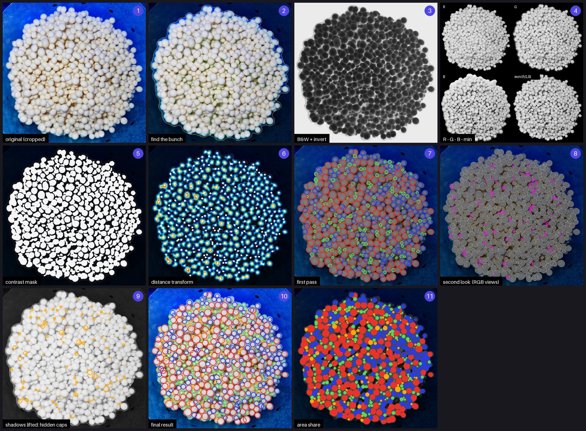

| ขั้น | ภาพ | ทำอะไร |
|---|---|---|
| 1 | original | ครอปเฉพาะบริเวณช่อ ให้ทุกขั้นเทียบกันในกรอบเดียวกัน |
| 2 | find the bunch | หาช่อ — เส้นเหลือง = ขอบช่อ เส้นเขียว = พื้นที่ช่อที่ใช้คิด % |
| 3 | B&W + invert | ขาวดำแล้วกลับสี ดอกกลายเป็นก้อนมืดบนพื้นสว่าง เห็นขอบและร่องระหว่างดอกชัด |
| 4 | R · G · B · min | ดูทีละช่องสีและค่าต่ำสุดของ 3 ช่อง (เฉพาะดอกขาวที่ยังสว่างทุกช่อง) |
| 5 | contrast mask | จุดที่สว่างกว่าบริเวณรอบข้าง = ตัวดอก ร่องมืดแบ่งดอกที่ติดกันออกจากกัน |
| 6 | distance transform | ยิ่งลึกเข้าไปในก้อนยิ่งร้อน จุดขาว = ศูนย์กลางดอก ค่าความลึก = รัศมี |
| 7 | first pass | วงรอบแรก สีตามขนาดเทียบดอกกลางของช่อ |
| 8 | second look (RGB views) | สแกนซ้ำหลายมุมสี วงม่วง = ดอกที่รอบแรกพลาด วงเทา = ที่เจอแล้ว |
| 9 | shadows lifted | ยกเงา ลบดอกเต็มวงออก เสี้ยวที่เหลือ (ส้ม) = ดอกที่ซ่อนใต้ดอกอื่น |
| 10 | final result | รวมทุกขั้น ตัดวงซ้ำ = จำนวนที่รายงาน |
| 11 | area share | ระบายสีตามชนิดดอกที่คลุมแต่ละพิกเซล เป็นที่มาของแถบ % พื้นที่ |

ภาพชุดนี้สร้างจากโค้ดจริงด้วย `python scripts/make_docs_images.py` (ภาพตัวอย่าง `samples/ช่อดอก/AElY1DQU.jpg` → 623 ดอก: เล็ก 168 · กลาง 163 · ใหญ่ 172 · ซ่อน 120)
</details>


**Numpad บนหน้าจอ:** ทุกช่องกรอกตัวเลขในเว็บ (เกณฑ์ผ่าน/ไม่ผ่าน, ตั้งค่านับดอก ฯลฯ) แตะแล้วมีแป้นตัวเลขเด้งขึ้นมา — ใช้ได้กับมือที่ใส่ถุงมือหรือแท็บเล็ตในห้องแล็บ มีปุ่ม ⌫ / C / ± / −step / +step, ตกลง (หรือแตะนอกแป้น) = เก็บค่า (ตัดให้อยู่ในช่วง min–max), ยกเลิก = คืนค่าเดิม, ตัวเลขแรกที่กดจะแทนที่ค่าเดิม และยังพิมพ์ด้วยคีย์บอร์ดจริงได้ (Enter = ตกลง, Esc = ยกเลิก) โค้ดอยู่ใน `initNumpad()` ของ `app.js`

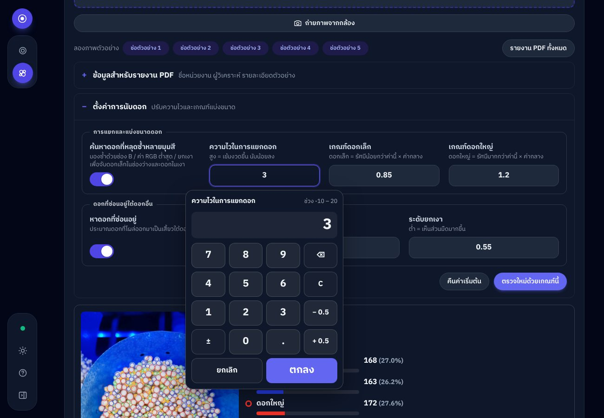
<sub>แผงตั้งค่าการนับดอก (จัดเป็นกลุ่ม ช่องเรียงตรงกัน) กับ numpad ที่เด้งใต้ช่องที่กำลังกรอก</sub>

> ข้อจำกัด: ควรถ่ายจากด้านบน แสงสม่ำเสมอ เห็นหน้าช่อชัด ดอกที่ถูกบังหรือซ้อนกันมากอาจนับขาด/เกินเล็กน้อย — ตรวจดูวงบนภาพผลลัพธ์ทุกครั้ง
> ตัวเลขเป็น "จำนวนดอกที่มองเห็นจากด้านบน" ไม่ใช่จำนวนดอกจริงทั้งช่อ

### 3) Codespaces
กด **Code → Codespaces → Create codespace** — ระบบติดตั้ง dependency และเปิดเว็บที่พอร์ต 8000 ให้

## รันบนเครื่องตัวเอง

```bash
pip install -r requirements-dev.txt
pytest -q                                   # ทดสอบ
python -m precision_qc samples -o reports   # วิเคราะห์ภาพตัวอย่าง
python -m precision_qc my_plates/ --set min_score=70 --set plate_cm=9 --strict
python scripts/build_site.py --serve        # เปิดเว็บที่ http://localhost:8000
```

---

## วิธีการวิเคราะห์

| # | ส่วนของรายงาน | วิธีคำนวณ |
|---|---|---|
| 1 | **Original + Scale** | หาขอบจานด้วย Hough transform → แปลง pixel เป็น cm จากขนาดจาน (ค่าเริ่มต้น 8.5 cm) วัดกว้าง×สูงของโคโลนี |
| 2 | **Whiteness** | ชดเชยแสง (white balance + exposure) แล้วคำนวณความขาวจากค่า CIE L\*a\*b\* : สว่างสูงและสีจาง = ขาว |
| 3 | **Fluffiness** | ความละเอียดของเส้นใยจาก Laplacian, local std และความหนาแน่นของขอบภายในโคโลนี |
| 4 | **Contamination filter** | จำแนกพิกเซลในจาน: เส้นใยสะอาด / วุ้นเปลือย (เหลือง-เบจ) / ปนเปื้อน (แดง-ส้ม-น้ำตาล, เขียว) / หมึกปากกา (น้ำเงิน-ม่วง — ไม่นับเป็นการปนเปื้อน) / พื้นที่มืด |
| 5 | **Color ratio Y/R/B** | สัดส่วนพื้นที่สีเหลือง แดง น้ำเงิน ต่อพื้นที่จาน |
| 6 | **Circularity** | สร้างขอบโคโลนีด้วย radial profile จากจุดศูนย์กลาง → Circularity (4πA/P²), IoU กับวงกลมอุดมคติ, Symmetry |
| 7 | **Color calibration** | เทียบสีเฉลี่ยของแต่ละกลุ่มกับสีมาตรฐาน (ΔE Lab) |
| 8 | **QC report** | คะแนนรวมถ่วงน้ำหนัก + เกรด + ผลตัดสิน |

**คะแนนรวม** = Growth 35% + Whiteness 25% + Fluffiness 25% + Shape 15%
(Growth score = การเจริญ ÷ 75% × 100, สูงสุด 100)

**เกรด**: A ≥ 80 (Excellent) · B ≥ 65 (Good) · C ≥ 50 (Fair) · D < 50 (Poor)

### เกณฑ์ PASS / FAIL (ปรับได้ทั้งในเว็บและ CLI)

ภาพ **ผ่าน** เมื่อไม่ติดเงื่อนไขใดเลย:

| รหัส | เงื่อนไข FAIL | ค่าเริ่มต้น |
|---|---|---|
| `Contaminated` | พื้นที่สีปนเปื้อน (แดง/น้ำตาล/เขียว) เกิน | 3 % |
| `Agar Exposed` | วุ้นเปลือยเกิน | 25 % |
| `Low Growth` | พื้นที่โคโลนีน้อยกว่า | 30 % |
| `Check Shape` | IoU รูปทรงน้อยกว่า | 0.60 |
| `Low Score` | คะแนนรวมน้อยกว่า | 60 |

ค่าทั้งหมดอยู่ใน `QCConfig` (`precision_qc/analyzer.py`) — ส่งผ่าน `--set key=value`, `--config file.json` หรือแผง “ตั้งค่า” บนเว็บ

### ผลกับภาพตัวอย่าง (`samples/`)

| ภาพ | ผล | คะแนน | สาเหตุ |
|---|---|---|---|
| white_colony | ✅ PASS | 83.0 (A) | — |
| labeled_plate | ✅ PASS | 80.4 (A) | หมึกปากกาบนฝาถูกแยกออก ไม่นับเป็นการปนเปื้อน |
| black_king_oyster | ❌ FAIL | 76.5 (B) | Agar Exposed (~34%) |
| sporulation | ❌ FAIL | 39.7 (D) | Contaminated, Low Growth, … |

รายงาน PNG ที่ CLI สร้าง (`<ภาพ>_report.png`) — ตัวอย่างที่ผ่านและไม่ผ่าน:

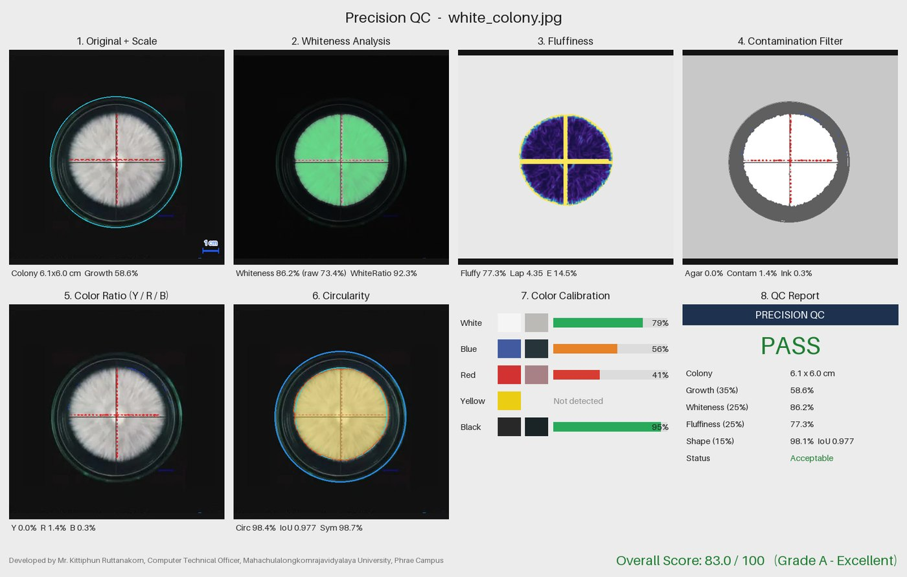
<sub>white_colony — PASS 83.0 (A)</sub>

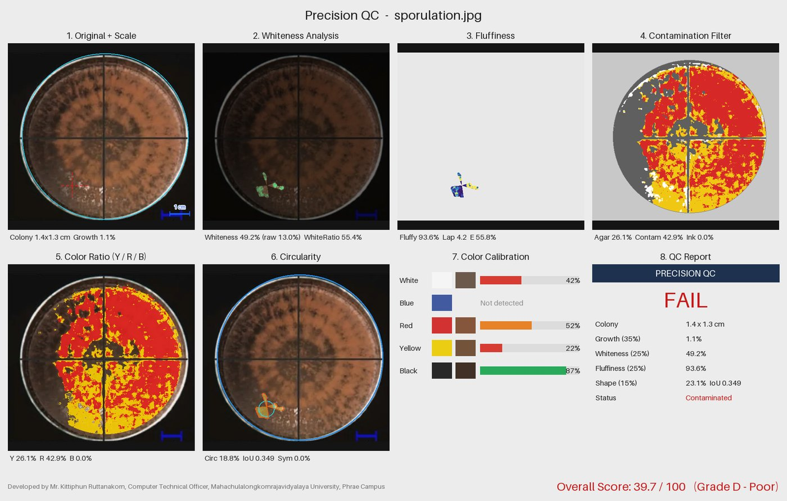
<sub>sporulation — FAIL 39.7 (D)</sub>

> ภาพตัวอย่างถูกตัดจากภาพหน้าจอรายงานเดิม จึงมีเส้นกากบาทติดมาด้วย — ใช้เพื่อสาธิตและทดสอบเท่านั้น
> สำหรับงานจริงควรถ่ายภาพจากด้านบน แสงสม่ำเสมอ จานอยู่กลางภาพ และปรับเกณฑ์ให้เข้ากับสายพันธุ์ที่เพาะ

## โครงสร้างโปรเจกต์

```
precision_qc/        Python engine
  analyzer.py        ตรวจจับจาน, จำแนกพิกเซล, คำนวณ metric, ตัดสิน PASS/FAIL
  render.py          สร้างภาพ 6 panel และรายงาน PNG
  api.py             JSON bridge ที่เว็บ (Pyodide) เรียกใช้
  batch.py           แยกจานหลายใบในภาพเดียว + จัดอันดับ  (--multi)
  caps.py            นับดอกเห็ดในช่อ แบ่งเล็ก/กลาง/ใหญ่  (--caps)
  cli.py             คำสั่ง batch  (python -m precision_qc)
web/                 หน้าเว็บ (เวอร์ชัน Pure.css) — โหลด Pyodide แล้วเรียก precision_qc.api
  index.html + app.js  หน้าตรวจจานเพาะเชื้อ (PASS/FAIL, PDF)
  caps.html + caps.js  หน้านับจำนวนดอกเห็ด (ช่อดอก)
  common.js          โค้ดที่สองหน้าใช้ร่วมกัน: ภาษา/ธีม, ตัวโหลดเอนจิน Python, ฟอร์ม, numpad
  i18n.js            ข้อความ 3 ภาษา (ไทย / English / 中文)
web-dashboard/       หน้าเว็บ (เวอร์ชัน Dashboard — ui-dash.js = แผงตั้งค่า/หน้าต่างเกี่ยวกับ-เครดิต, img/ = ตราและรูปผู้พัฒนา) — ใช้ Tailwind CSS มาตรฐานล้วน (สี slate/indigo/emerald/rose)
  src.css            ต้นทาง Tailwind (คอมไพล์เป็น tw-dash.css ตอน build) — ทุกส่วนเขียนด้วย @apply utility มาตรฐาน
  tailwind.config.js ตั้งค่า dark mode ให้ตามปุ่มสลับธีม/ระบบ (ไม่มีสี/ค่า custom)
scripts/make_docs_images.py  สร้างภาพประกอบใน README ที่วาดจากเอนจินจริง (docs/img/*.jpg)
scripts/build_site.py  ประกอบเว็บทั้งสองเวอร์ชัน (Pure.css + Dashboard) + โค้ด Python ลง _site/ (หรือ deploy/)
deploy/              ไฟล์พร้อมอัปโหลดขึ้นโฮสต์จริง (สร้างจาก build_site.py — อย่าแก้ไฟล์ในนี้ตรง ๆ)
hosting/.htaccess    ค่าเซิร์ฟเวอร์ Apache ที่ build ใส่ลงใน deploy/
hosting/protect.js   ระบบล็อกโดเมน + กันคัดลอก ที่ build ใส่ลงใน deploy/
samples/             ภาพตัวอย่าง
docs/img/            ภาพประกอบ README (ภาพหน้าจอเว็บและรายงาน PDF ถ่ายจากเว็บที่ build แล้ว ส่วนที่เหลือสร้างด้วย scripts/make_docs_images.py)
inputs/              วางภาพที่นี่เพื่อให้ QC Batch workflow ตรวจ
tests/               pytest
.github/workflows/   CI, QC Batch, Pages deploy
```

## ผู้พัฒนา / Developer

**นายกิตติพันธ์ รัตนคร** นักวิชาการคอมพิวเตอร์
มหาวิทยาลัยมหาจุฬาลงกรณราชวิทยาลัย วิทยาเขตแพร่

**Mr. Kittiphun Ruttanakorn**, Computer Technical Officer
Mahachulalongkornrajavidyalaya University, Phrae Campus
